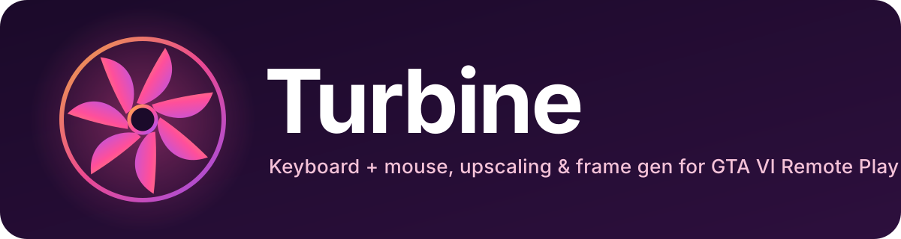

Turbine is a userscript for playing **GTA VI over Xbox Remote Play in the browser** (`play.xbox.com`). It turns your keyboard and mouse into a virtual Xbox controller with GTA-style controls, mouse look and a car mode. It also adds a GPU upscaler, frame generation that doubles a 30 fps stream to 60 fps, and low-latency stream settings.

It works with any game on Xbox Remote Play or Xbox Cloud Gaming; the defaults are tuned for GTA VI.

It doesn't modify the Xbox site's code. It adds a virtual controller through the browser's Gamepad API and draws the stream through its own WebGL layer, so site updates are less likely to break it.

## Install

1. Install [Tampermonkey](https://www.tampermonkey.net/) in Chrome or Edge.
2. Open **[turbine.user.js](https://raw.githubusercontent.com/rpatty-dev/turbine/main/turbine.user.js)** and click **Install**.
3. Go to `play.xbox.com`, start Remote Play on the console running GTA VI, and click the video once to lock the mouse.

If you use Better xCloud, turn it off on `play.xbox.com`, because the two conflict there.

## Controls

| Key | Controller | GTA VI (on foot / in a car) |
|---|---|---|
| W A S D | Left stick | Move / steer |
| Mouse | Right stick | Camera / aim |
| I J K L | Right stick | Camera, keyboard backup |
| Shift | A | Sprint / handbrake |
| B | B | Melee, reload / cinematic cam |
| Space | X | Jump / brake, reverse |
| Y | Y | Enter or exit vehicle (also switches car mode) |
| Left click | RT | Shoot / accelerate |
| Right click | LT | Aim / brake |
| Q / F | LB / RB | Weapon wheel / cover |
| X / C | L3 / R3 | Crouch / look behind |
| Arrow keys | D-pad | Phone, interaction menu |
| P | Menu | Pause |
| [ | View | Map |
| ` | Xbox button | Guide |

| Key | Turbine |
|---|---|
| G | Switch car mode by hand. In car mode, W is gas (RT) and S is brake (LT) |
| F7 | Frame generation on / off |
| F8 | Controller emulation on / off |
| F9 | Stats overlay on / off |
| F10 | Upscaler on / off |
| Esc | Release the mouse |

The GTA VI column follows the classic GTA console layout. If a control is on a different button in GTA VI, or you remap it in the game, change the `BUTTONS` and `STICKS` settings at the top of the script.

## Features

- **Virtual controller:** keyboard and mouse appear to the site as a standard Xbox controller, so every game accepts the input.
- **Mouse look:** mouse movement drives the right stick, and is read with `pointerrawupdate` so it reaches the game as soon as the OS reports it.
- **Low-latency stream:** shrinks the WebRTC receive buffer (`jitterBufferTarget`). Set `JITTER_BUFFER_MS` to `30` if the stream stutters on weak Wi-Fi.
- **Upscaler:** draws the stream at your screen's native resolution on the GPU and sharpens it with AMD FidelityFX CAS (contrast adaptive sharpening). Adjust with `UPSCALE_SHARPNESS`.
- **Frame generation:** estimates motion between stream frames on the GPU and draws warped in-between frames. It turns on only when your display refreshes faster than the stream: a 30 fps stream on a 60 Hz screen becomes 60 fps, and a 60 fps stream on a 120 Hz ProMotion screen becomes 120 fps.
- **Stats overlay:** shows resolution, fps, ping, buffer delay, decode time and packet loss, so you can see the effect of each setting.

### Frame generation trade-offs

To draw a frame between two real ones, Turbine has to wait for the second one. That adds about half a stream frame of delay: around 17 ms at 30 fps, 8 ms at 60 fps. Generated frames can show smearing around edges, HUD elements and fast motion. Turn it off with F7 for competitive play.

## Tips

- **Game settings:** if GTA VI offers a performance or high-frame-rate graphics mode on your console, use it. A higher stream frame rate cuts input delay more than frame generation can.
- **Network:** connect the console to the router with Ethernet, and use 5 GHz Wi-Fi or Ethernet on the computer.
- **Console:** in Xbox Settings → Devices & connections → Remote features, pick the lowest-latency quality option if your console offers one.

## Credits

- Sharpening is based on [AMD FidelityFX CAS](https://github.com/GPUOpen-Effects/FidelityFX-CAS) (MIT).
- Inspired by [Better xCloud](https://github.com/redphx/better-xcloud).

Turbine isn't affiliated with or endorsed by Rockstar Games, Take-Two Interactive, Microsoft or Xbox. Grand Theft Auto and GTA VI are trademarks of Take-Two Interactive. Use it with your own console and account. Emulating a controller with a mouse may be against the rules in some online games.

## License

MIT
